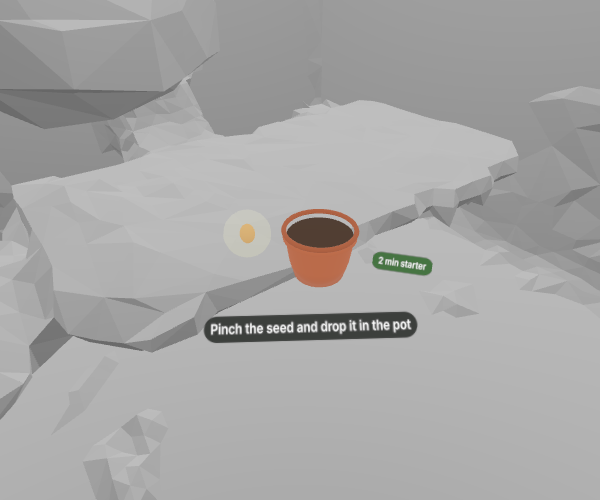
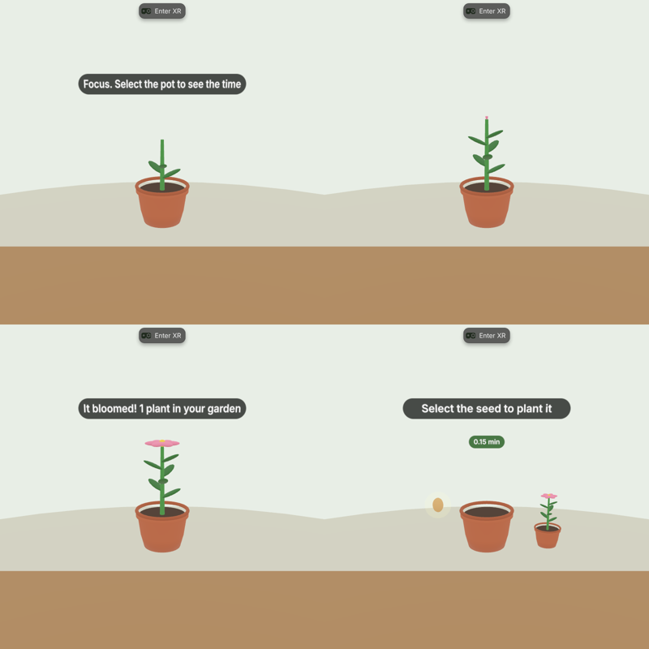
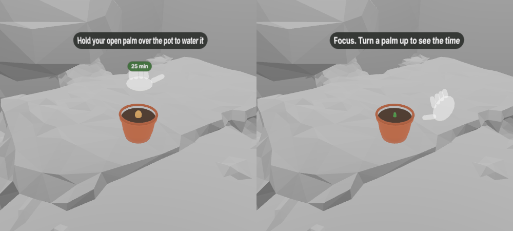
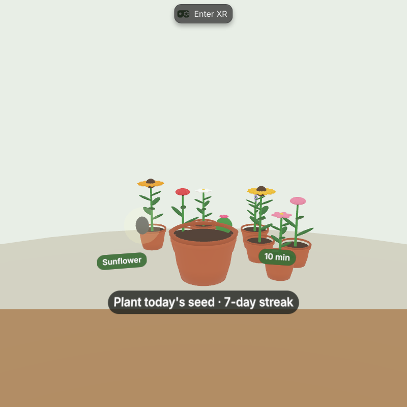
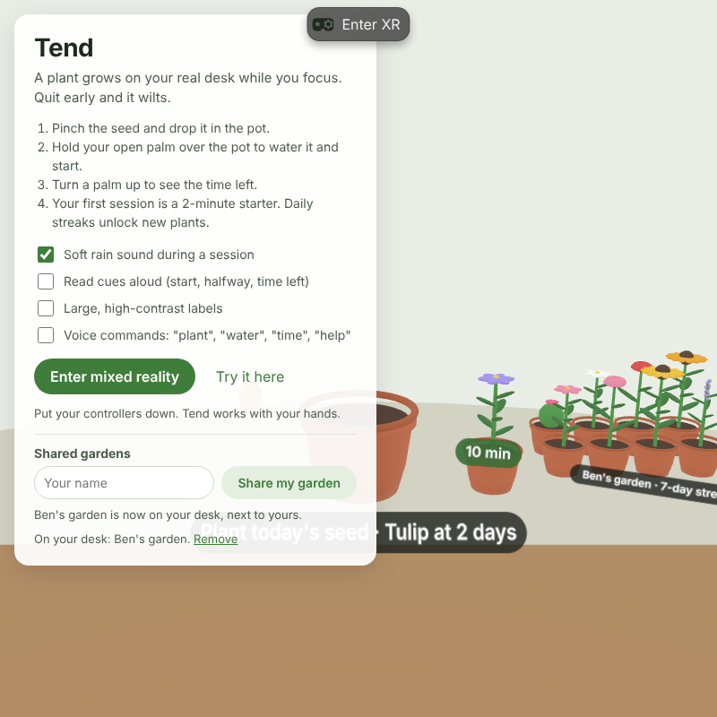

# Tend

**Tend helps you finish focus sessions by growing a plant on your real desk, using only your hands.**

A hands-first mixed reality focus timer for Meta Quest, built with the Immersive
Web SDK (IWSDK, WebXR) for the Meta VR Start Developer Competition 2026,
Productivity track, New Experience division.

**Try it:** https://softalpha0.github.io/Tend/ (open in the Meta Quest Browser, then tap *Enter mixed reality*)

**Demo video:** [YouTube link]



## The problem

Focus apps live on the phone, and the phone is the distraction. You open the
timer, see a notification, and the session is gone. Headsets can now show your
real room, so a timer doesn't need a screen at all: it can sit on your desk and
wait for you.

## What it does

A small pot appears on your real desk. You pinch a seed out of the air and drop
it in, then hold your open palm over the pot to water it. That starts a focus
session, and the plant grows while you work. Turn a palm up at any time to see
the time left as a ring of leaves. When the session ends the plant blooms and
moves into a garden of small pots around your desk, which grows a little every
day you come back. Quit early and the plant wilts.



## Features (all working now)

- **Hands only, end to end.** Plant, water, check the time, change session length, move the pot and end a session without a controller. Controllers and a mouse also work as a fallback.
- **Your real desk.** Plane detection finds a surface at desk height that you are facing and puts the pot near its front edge.
- **Persistent spatial anchor.** The pot is pinned to the room with a WebXR persistent anchor, so it and your garden are exactly where you left them next time. Without anchor support, it falls back to its saved spot on the desk.
- **A 2-minute starter.** Your first session is two minutes, so you see a bloom before you take the headset off. After that choose 5, 10, 25 or 50 minutes.
- **Clean pause and resume.** Taking the headset off or opening the system menu pauses the session. Only quitting on purpose (pinch and hold the pot for 2 seconds) wilts the plant.
- **Something to come back to.** Finished plants stay in your desk garden, and a daily streak is shown when you return.
- **Plants unlocked by streaks.** Daisy is available from the start; a 2-day streak unlocks Tulip, 3 days Sunflower, 5 days Lavender and 7 days Cactus flower. Unlocks are kept even if a streak breaks. Pinch the species chip beside the pot to choose your seed.
- **A living garden.** Plants sway in a gentle breeze, and touching one with your fingertip makes it bend away and spring back with a rustle and a few sparkles. Butterflies live in your garden (one per streak day, up to three) and visit the flowers; hold your palm up and one lands on your hand. A bloom releases a burst of golden pollen, glowing motes drift up from the soil while you focus, and soft contact shadows ground every pot on your real desk.
- **Seasonal plants.** Each season has its own plant anyone can grow while it lasts: Winter rose (Dec to Feb), Cherry blossom (Mar to May), Hibiscus (Jun to Aug) and Chrysanthemum (Sep to Nov).
- **Weekly summary.** The start card shows your last seven days (sessions, minutes focused and streak). In mixed reality, turn a palm up while the pot is empty, or say "this week".
- **Shared gardens.** Enter your name and tap *Share my garden* on the start card to get a link. When a friend opens it, your garden appears on their desk beside their own, labelled with your name and streak.
- **Live shared gardens** (optional, with Supabase). Each person gets a friend code. Add a friend's code, or open their share link, and their garden stays up to date on your desk as they grow new plants. Without Supabase set up, sharing works by link and shows a snapshot.
- **Installable app.** Tend has a web app manifest, icons and offline support, so it can be installed from the Quest Browser and opens straight into mixed reality.
- **Onboarding without text walls.** A translucent ghost hand demonstrates each gesture until you have done it once. If the pot is out of view, an arrow points to it.
- **Field-of-view aware.** Labels sit low and close to the pot so they stay inside a narrow field of view.
- **Accessibility options** on the start card:
  - one-handed use for every gesture, with generous grab zones
  - spoken cues for the start, halfway point, two minutes left, the result, and the time left on palm-up
  - voice commands ("plant", "water", "time", "help", "end session") in browsers with the Web Speech API
  - large, high-contrast labels
  - tones for every milestone, so a session can be followed without looking
  - a soft rain ambient sound during sessions (can be turned off)







## How it works

| Part | Technology |
| --- | --- |
| XR runtime and ECS | [Immersive Web SDK](https://iwsdk.dev) 1.0.1 (Three.js) |
| Finding the desk | WebXR plane detection, through IWSDK scene understanding |
| Keeping the pot in place | WebXR anchors with Meta Quest Browser persistent handles |
| Gestures | Hand joint poses read each frame: pinch from thumb-to-index distance, palm-up from the palm's normal |
| Models | Procedural Three.js geometry: no model files to download |
| Sound | Web Audio synthesis and the Speech Synthesis API |
| Saved progress | `localStorage`: garden, streak, unlocked plants, friends' gardens, settings, session timing |
| Shared gardens | A snapshot encoded into the share link, validated when opened |
| Live shared gardens | Supabase (Postgres): a public view and one function; see `supabase/schema.sql` |
| Installable app | Web app manifest, icons and a service worker for offline start |
| Hosting | GitHub Pages, built by GitHub Actions |

## Run it locally

Needs Node 22 (see `.nvmrc`). No API keys or environment variables are needed.

```sh
npm install
npm run dev
```

`npm run dev` opens a browser with IWER, IWSDK's emulator of a Quest 3 in a
sample living room, so you can test without a headset. To try it on a Quest on
the same Wi-Fi, open a network URL from `npx @iwsdk/cli dev status` in the
Quest Browser and accept the local certificate warning.

Add `?minutes=0.2` to the URL for a 12-second session while testing.

On Windows, if `npm run dev` stops with "Cannot establish this process birth
identity", PowerShell is starting slowly. Retrying usually works.

## Set up live shared gardens (optional)

1. Create a free project at [supabase.com](https://supabase.com).
2. In the dashboard, open **SQL Editor**, paste the contents of `supabase/schema.sql` and click **Run**.
3. Open **Project Settings > API** and copy the **Project URL** and the **anon public** key.
4. Paste them into `src/sync-config.ts`, then commit and push.

The anon key is meant to be public. The database rules in `schema.sql` let anyone read the public part of a garden by its friend code, and only the device that created a garden can change it: each device keeps a random secret, and the database stores only its hash.

## Deploy

Push to `main` on GitHub, then set **Settings > Pages > Source** to
**GitHub Actions**. The workflow in `.github/workflows/deploy.yml` builds and
publishes the site.

## Project layout

```
iwsdk.config.json     XR features (hand tracking, plane detection, anchors) and world settings
index.html            Start card shown in the browser, with settings
src/index.ts          Creates the world and registers the systems
src/tend-system.ts    Placement, session state machine, gestures, onboarding, visuals
src/hands.ts          Hand joints each frame: pinch, palm up, palm position
src/anchor.ts         Persistent spatial anchor for the pot
src/models.ts         Procedural pot, seed, plant, time ring, labels, ghost hand, finder arrow
src/state.ts          Saved progress and settings
src/effects.ts        Contact shadows, focus motes, bloom burst, ripples, butterflies
src/sound.ts          Synthesized cues, ambient rain, spoken announcements
src/voice.ts          Optional voice commands
src/species.ts        Plant species and their streak unlocks
src/share.ts          Shared-garden links
src/sync.ts           Live shared gardens (Supabase)
src/sync-config.ts    Your Supabase project URL and anon key
supabase/schema.sql   Database table, view and function for live sync
public/manifest.webmanifest, public/sw.js, public/icons/   Installable app
```

The `AGENTS.md`, `CLAUDE.md`, `.claude/`, `.cursor/`, `.codex/` and
`.github/instructions/` files come from the IWSDK project template and give AI
coding tools context about IWSDK.

## Team

Softalpha (Uguru Benjamin), solo developer. Built during the competition window,
starting October 29, 2026, with an AI coding assistant.

## What's next

- Tune gesture thresholds from more real-headset playtests
- Build and sign the Quest app package (Trusted Web Activity) and submit to the Meta Horizon Store, targeted for Q1 2027
- Visit a friend's garden together in shared mixed reality
- Gentle daily reminders to keep a streak going

## License

MIT. See [LICENSE](LICENSE).
